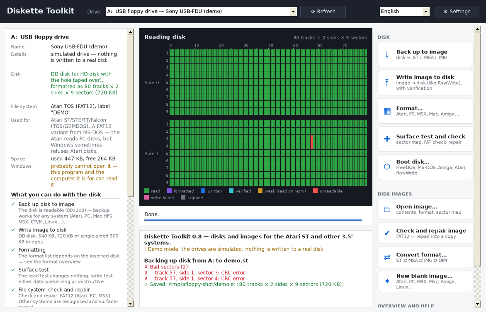
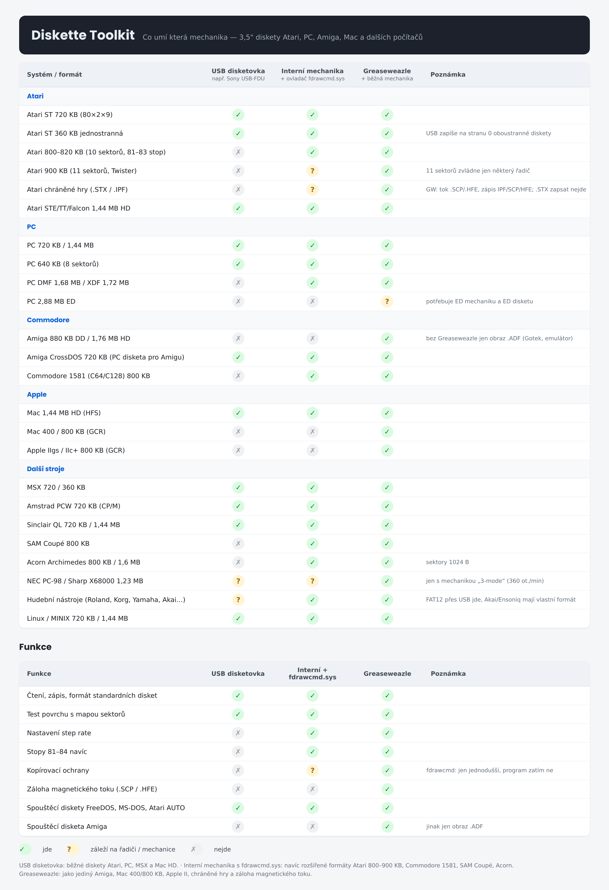

# Diskette Toolkit

Read, write, format and test floppy disks and disk images for the **Atari ST** and many other 3.5" systems
(PC, MSX, Mac, Amiga, Amstrad PCW, MINIX, Linux…) on Windows. Inspired by the Atari program FastCopy:
a live sector map shows every track being read, formatted, written and verified.

*Česky: návod je v souboru [NAVOD.txt](NAVOD.txt).*

## Download

Get the latest ZIP from [Releases](../../releases), unzip it anywhere and run `DisketteToolkit.exe`
(administrator rights are needed for direct drive access). No installation — only .NET Framework 4.8,
which is part of Windows 10 and 11 (Windows 7 SP1 / 8.1 need it installed).

Try it without hardware: `DisketteToolkit.exe --demo` (simulated drives).

## Supported drives

| Drive | What it can do |
|---|---|
| USB floppy drive | standard PC formats only (640 KB, 720 KB, 1.44 MB) |
| Internal drive + [fdrawcmd.sys](https://simonowen.com/fdrawcmd/) | also Atari 800–900 KB (10/11 sectors, up to 84 tracks), DMF, 128–1024 byte sectors, step rate |
| [Greaseweazle](https://github.com/keirf/greaseweazle) | everything incl. Amiga, Mac GCR, flux backups (.scp/.hfe) and writing IPF/SCP/HFE |

The program downloads gw.exe and fdrawcmd.sys itself when you need them.

## Features

- Backup to image (.ST, .MSA, .IMG, .DIM, .ADF, flux .SCP/.HFE) and write images back with verification
- Format profiles for Atari, PC, MSX, Mac HFS, Amiga CrossDOS, Amstrad PCW, MINIX, ext2
- Surface test (read-only, write test with restore, destructive) with a FastCopy-style map
- FAT12 check and safe repair (backup first, only changed sectors written, repairs of images go to a copy)
- Boot disks: FreeDOS, MS-DOS from your own Windows (`diskcopy.dll`), Amiga bootblock, Atari AUTO folder, RawWrite
- Image tools: open and extract files, check/repair, convert, create blank images
- Czech and English UI; add a language with a `xx.lang` file (Settings → *Create a template for a new language*)
- Command line: `dtk.exe` (Czech only for now)

## Feedback

Bug reports and ideas are welcome in [Issues](../../issues). Please include the program version, Windows version,
drive type and the log (right-click the log → *Save log to file…*).

## Building

C# / .NET Framework 4.8. On Windows: `dotnet build src/Gui/Gui.csproj -c Release`.
On Linux the build uses Mono reference assemblies (`/usr/lib/mono/4.8-api`); tests run with
`mono tests/bin/Release/net48/AtariFloppy.Tests.exe`.

## Licence

[GNU GPL v3](LICENSE). The FreeDOS boot sector embedded in the program is GPL v2 or later
(see [third_party/freedos](third_party/freedos)). FreeDOS, Greaseweazle tools and fdrawcmd.sys are not bundled —
the program downloads them from their official sources when needed.

© HoroPC (Wary)
