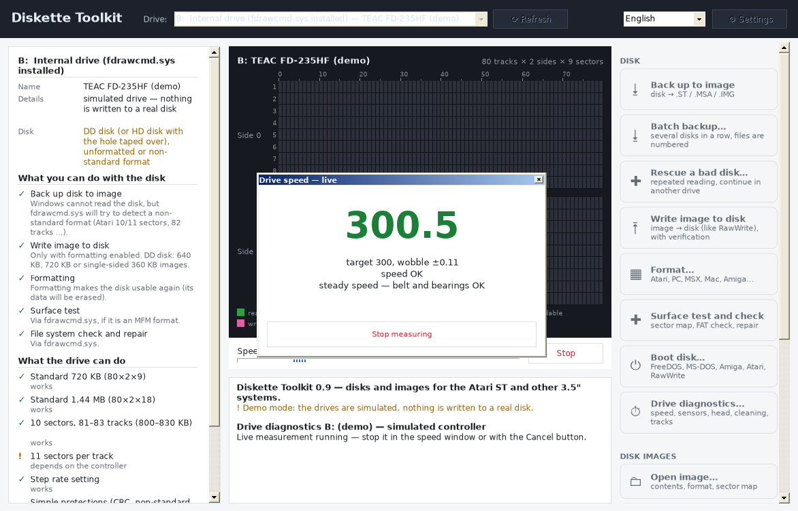
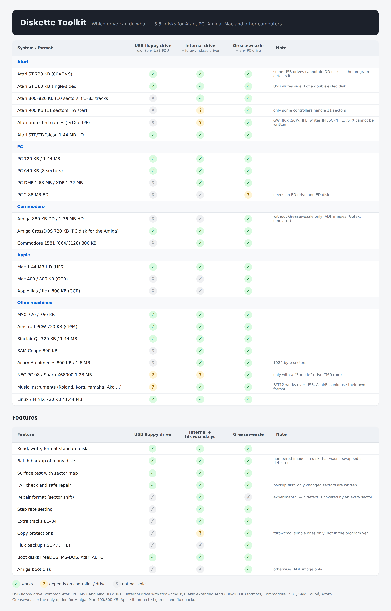

# Diskette Toolkit

Read, write, format and test floppy disks and disk images for the **Atari ST** and many other 3.5" systems
(PC, MSX, Mac, Amiga, Amstrad PCW, MINIX, Linux…) on Windows. Inspired by the Atari program FastCopy:
a live sector map shows every track being read, formatted, written and verified.

*Česky: návod je v souboru [NAVOD.txt](NAVOD.txt), přehled mechanik v [docs/drives-cs.png](docs/drives-cs.png).*

## Download

Get the latest ZIP from [Releases](../../releases), unzip it anywhere and run `DisketteToolkit.exe`
(administrator rights are needed for direct drive access). No installation — only .NET Framework 4.8,
which is part of Windows 10 and 11 (Windows 7 SP1 / 8.1 need it installed).

Try it without hardware: `DisketteToolkit.exe --demo` (simulated drives).

See also: [Privacy](#privacy) · [Code signing policy](#code-signing-policy)

## What's new in 0.9

- **Drive diagnostics** (Greaseweazle, internal drive + fdrawcmd.sys): drive speed with wobble and a live gauge
  for turning the speed trimmer, warm-up test, sensor check, head to track 0 / 79 / sweep, step accuracy test,
  head cleaning, repeated track read (dirty head or damaged disk?), USB bandwidth test, flux histogram per track
- **Rescue a bad disk**: many retries per unreadable sector, continue in another drive (only missing sectors are
  read), and at the end advice whether another drive can still help or the spot is lost
- **Rescue sectors from flux**: open a Greaseweazle `.scp`, decode it with the built-in MFM decoder, combine captures
  of the same disk from several drives into one image
- Error reason for every failed sector in the map, read history (disk or drive?), disk grade A/B/C after a write test
- Safer Greaseweazle writes: USB bandwidth is checked first, a write that would stop mid-track is not started
- The FAT check leaves boot loaders and other non-FAT disks alone

Tested on real hardware with a Greaseweazle V4.1 (NEC, Samsung and ALPS drives; HD and DD disks) and a
Sony USB-FDU. The diagnostics on an internal drive with fdrawcmd.sys are **not verified on real hardware yet**.

> On some desktop PCs with an AMD AM5 board (B650, X670, X870) the USB controller feeds slow USB devices too
> slowly for Greaseweazle **writes** (reading works). Use another computer or an add-in PCIe USB card;
> *Drive diagnostics → USB bandwidth test* shows whether your port is fast enough.

## Supported drives

| Drive | What it can do |
|---|---|
| USB floppy drive | standard PC formats only (640 KB, 720 KB, 1.44 MB) |
| Internal drive + [fdrawcmd.sys](https://simonowen.com/fdrawcmd/) | also Atari 800–900 KB (10/11 sectors, up to 84 tracks), DMF, 128–1024 byte sectors, step rate; drive diagnostics |
| [Greaseweazle](https://github.com/keirf/greaseweazle) | everything incl. Amiga, Mac GCR, flux backups (.scp/.hfe) and writing IPF/SCP/HFE; drive diagnostics |

The program downloads gw.exe and fdrawcmd.sys itself when you need them.

## Features

- Backup to image (.ST, .MSA, .IMG, .DIM, .ADF, flux .SCP/.HFE) and write images back with verification
- Format profiles for Atari, PC, MSX, Mac HFS, Amiga CrossDOS, Amstrad PCW, MINIX, ext2
- Batch backup: a box of disks one after another into numbered images (disk-001.st, disk-002.st…)
- Drag an image file onto the window to open it
- Drive diagnostics (internal drive + fdrawcmd.sys, Greaseweazle): speed with wobble and a live gauge for adjusting, sensor check, head moves and cleaning, repeated track read (dirty head vs. damaged disk), track layout listing (fdrawcmd.sys), warm-up and step accuracy tests, flux histogram and USB bandwidth test (Greaseweazle)
- Rescue a bad disk: many retries per unreadable sector, continue in another drive (only the missing sectors are read), advice whether another drive can still help, experimental bit voting from bad reads (fdrawcmd.sys); rescue sectors from saved Greaseweazle flux (.scp) with an own MFM decoder, combining captures from several drives
- Error reason for every failed sector in the map, read history that tells a faulty drive from a faulty disk, disk grade (A/B/C) after a write test
- Surface test (read-only, write test with restore, destructive) with a FastCopy-style map
- Experimental repair format (internal drive + fdrawcmd.sys): a defect on a track is covered by an extra sector instead of being marked bad in the FAT
- FAT12 check and safe repair (backup first, only changed sectors written, repairs of images go to a copy)
- Boot disks: FreeDOS, MS-DOS from your own Windows (`diskcopy.dll`), Amiga bootblock, Atari AUTO folder, RawWrite
- Image tools: open and extract files, check/repair, convert, create blank images
- Czech and English UI; add a language with a `xx.lang` file (Settings → *Create a template for a new language*)
- Command line: `dtk.exe` (Czech only for now)

## How it is made

I design, test and maintain Diskette Toolkit myself; the code is written with AI assistance (Claude).
Every change goes through a pull request that I review and test before it is merged.

## Feedback

Bug reports and ideas are welcome in [Issues](../../issues). Please include the program version, Windows version,
drive type and the log (right-click the log → *Save log to file…*).

## Support

Diskette Toolkit is free. If it saved your disks, you can support it on [GitHub Sponsors](https://github.com/sponsors/Warysek)
or buy me a coffee on [Ko-fi](https://ko-fi.com/wary) — it helps with test disks and drives. Thank you!

## Building

C# / .NET Framework 4.8. On Windows: `dotnet build src/Gui/Gui.csproj -c Release`.
On Linux the build uses Mono reference assemblies (`/usr/lib/mono/4.8-api`); tests run with
`mono tests/bin/Release/net48/AtariFloppy.Tests.exe`.

## Privacy

Diskette Toolkit does not collect or send any data about you or your computer. It only connects to the internet
when you ask it to download an add-on, and then only to the official sources:
GitHub (Greaseweazle Host Tools, `api.github.com` / `github.com`), ibiblio.org (FreeDOS for boot disks) and
simonowen.com (fdrawcmd.sys driver installer). The *Support development* button opens Ko-fi in your browser.

## Code signing policy

Windows releases are going to be signed. Free code signing provided by [SignPath.io](https://signpath.io),
certificate by [SignPath Foundation](https://signpath.org) *(application in progress)*.

- Builds come only from this repository, built by GitHub Actions ([Build workflow](.github/workflows/build.yml)).
- Committers and reviewers: [Warysek](https://github.com/Warysek)
- Approvers (approve every signing request): [Warysek](https://github.com/Warysek)
- All changes go through pull requests reviewed and merged by the maintainer.
- Add-ons that the program downloads on request (Greaseweazle Host Tools, fdrawcmd.sys, FreeDOS) are not part of
  the signed package and keep their own authors' signatures and licences.

## Licence

[GNU GPL v3](LICENSE). The FreeDOS boot sector embedded in the program is GPL v2 or later
(see [third_party/freedos](third_party/freedos)). FreeDOS, Greaseweazle tools and fdrawcmd.sys are not bundled —
the program downloads them from their official sources when needed.

© HoroPC (Wary)
